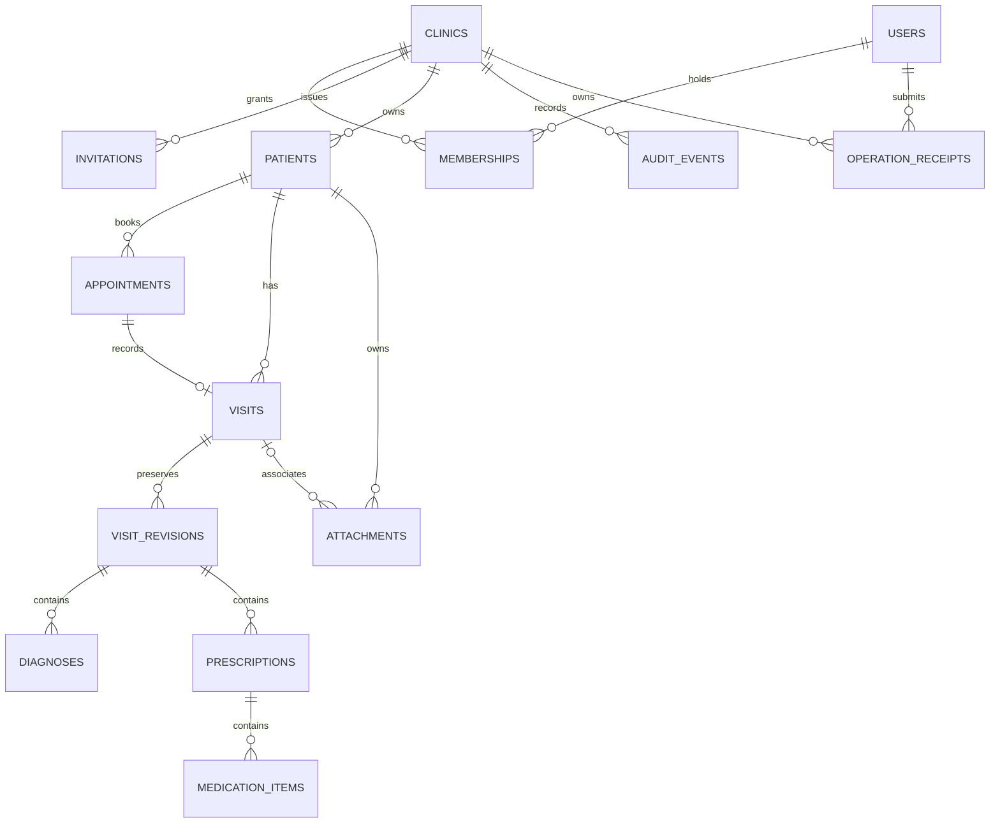

# Implementation decisions — updated 29 August 2026

Status: active development implementation. Nine migrations through private documents, immutable completed-visit amendments, and hardened Doctor-device presence/explicit receipts are deployed to `clinic-chatgpt-dev` (`geikkygtnsgbtajyqdvc`). Existing `clinicdb` is explicitly excluded. Local/PGlite, hosted schema, mobile runtime, and authenticated two-device acceptance remain separate milestones; see `CONTINUE-HERE.md` for verified results.

**The security, offline, file, and operational behavior described below is the intended release design, not a claim that every control exists or has passed validation.** Current implemented API contracts and remaining endpoints are listed in `docs/api-contract.md`.

## Scope and safety

Two independently installable Flutter applications share reusable features and one future development backend. Doctors administer their own clinic and can access all its patients; assistants manage demographics, scheduling, queue and authorized documents. Clinical read access is explicit. Assistants cannot author or sign clinical records. Application permissions are not database administrator rights.

Clinic names are display labels. UUID clinic membership is the isolation boundary. Installation does not create a database. Doctor registration creates a private clinic workspace; authenticated assistants join using a single-use, expiring invitation. No public search by clinic or doctor name grants membership. Future branches, multiple doctors and additional roles use the same clinic-owned record model.

Only fictional data may be used during development. This is not regulatory certification or a clinical deployment. Egyptian privacy, retention, medical record amendment, cross-border hosting, backup, support access and release approval require specialist review before real patient data.

## Technology choices

| Area | Decision and tradeoff |
|---|---|
| Backend | Supabase PostgreSQL, Auth, private Storage, Realtime; no paid provisioning without approval |
| Client | Flutter, Android/iOS applications; phone navigation and responsive two-pane layouts |
| State/DI | Riverpod providers and constructor injection; BLoC is a valid more explicit event/state alternative, Provider requires more manual asynchronous state handling |
| Routing | go_router for authenticated routes, selected clinic and patient/visit navigation |
| Local data | Drift over encrypted SQLite3MultipleCiphers; relational queries and migrations, unlike a single history JSON document |
| Local alternatives | Isar is convenient object storage but less aligned with the relational domain; raw SQLite has the right engine but requires hand-maintained mapping and reactive queries |
| Tokens/keys | OS secure storage. No service-role/database secrets in mobile builds |
| Sync | Transactional local outbox, expected server versions and persistent conflicts; Supabase Realtime is an invalidation signal, not an offline database |
| Testing | Flutter unit/widget tests, local PostgreSQL-compatible tests, later hosted RLS/Storage/Realtime and two-device integration tests |

Dependencies are pinned and lockfiles must be retained. Local development uses isolated Flutter 3.47.2 stable / Dart 3.13.2. The user's incomplete shared SDK has not been replaced. Platform release validation remains required.

## Provider comparison supplement

| Criterion | Supabase | Firebase | Appwrite | Custom Node.js + PostgreSQL |
|---|---|---|---|---|
| Medical relational model | Native PostgreSQL | Firestore is document-oriented; Data Connect is a separate PostgreSQL-based option | Managed database abstractions and relationships | Full relational control |
| Live updates | Realtime subscriptions | Strong Firestore listeners | Realtime subscriptions | WebSocket/SSE design and operation required |
| Offline | Client database/sync design required | Firestore SDK cache and queued writes; medical conflicts still need explicit policy | Client cache/sync design required | Entirely application-owned |
| Auth/authorization | Auth plus database RLS and storage policies | Auth, Security Rules/IAM; Data Connect has a separate authorization model | Auth and document/resource permissions | Identity integration and all authorization must be designed |
| Files/search | Private Storage; PostgreSQL text/trigram indexes | Cloud Storage; Firestore full text generally uses another search service | Storage and supported query/search abstractions | Object storage and PostgreSQL/search service chosen separately |
| Scale/operations | Managed database with quotas, capacity planning and tuning | Managed services; costs depend strongly on selected products and operations | Managed or self-hosted; operator responsibility differs | Most operational work, most hosting flexibility |
| Backups/security | Plan-dependent features; application audit and restore tests still required | Product-specific backup/export and security configuration | Deployment/plan-dependent backup and hardening | Entire backup, restore, logging and security operation owned by team |
| Portability/effort | PostgreSQL portable; Auth/Storage/Realtime integrations still need migration work | Firestore data/listener model has greater coupling; Data Connect is distinct | API/data permission mapping required on migration | Lower provider coupling, highest initial delivery/maintenance effort |
| Flutter maturity | Official Flutter SDK | Official Flutter integrations | Official Flutter SDK | Standard HTTP/WebSocket clients; custom client contracts |
| Cost | Free test tier within quotas, not a production commitment | Free quotas and product-specific billing; verify chosen services | Free/paid cloud or self-hosting infrastructure | OSS database, but servers, storage and operations cost money |

Decision: Supabase for a fictional-data test, with replaceable repository/auth/storage boundaries. None is automatically suitable or compliant merely by being selected. This is a fit assessment, not a performance benchmark.

## Project boundaries

`apps/assistant` and `apps/doctor` own platform identity and entry points. `packages/clinic_core/lib/src/features` owns feature presentation, controllers and domain/data adapters. Pure domain objects do not depend on Supabase. `core` contains configuration, errors, encryption and sync primitives. A future provider change replaces adapters and migration tooling, not medical workflows.

## Data relationships and invariants

This diagram covers the original local relational foundation. Invitations, command receipts, Doctor presence, and explicit appointment receipts are private-schema tables. The queue derives from appointment state; durable sync-cursor/tombstone entities remain future work. Medication items are the `prescription_items` table.

Every clinic-owned relationship must be composite or checked against the same clinic. UUID primary identities work offline. Human patient numbers are clinic-scoped, allocated on the server and never security credentials. Age is derived from date of birth and display date. DOB is a calendar date, not a UTC timestamp. Appointment instants are stored in UTC and displayed using the clinic's Africa/Cairo time zone, including daylight saving changes.

No arbitrary patient/visit/medication/attachment count limit is part of the domain. Pagination and byte quotas still apply. Foreign keys and clinic/date/status indexes support bounded queries. Search uses normalized names, trigram indexes, digit-normalized phones and exact/prefix patient identifiers. Search pages return enough identity details to distinguish namesakes. Cross-clinic matching/merging is forbidden. Full history is relational; JSON is limited to transport, outbox payloads and audit snapshots.

Clinical finalization creates an immutable revision. Later corrections create another revision with actor, timestamp and reason. Historical diagnoses and medication items remain attached to the original revision. Archive tombstones are retained and synchronized. Permanent deletion and retention expiry are privileged, separately reviewed operations, never a receptionist action.

## API and authorization boundary

Auth uses provider sign-in/sign-up/recovery endpoints with publishable credentials only. Distinct native recovery callbacks and the replacement-password UI are implemented; the hosted redirect allowlist and email flow still require configuration/acceptance. Authenticated reads use RLS-protected tables/views. Writes go through explicit validated command/RPC contracts; direct table mutation privileges are not granted to app roles. Each command validates current clinic membership, clinician/assistant capability, entity scope, expected version and operation UUID. Authorization is performed before idempotent replay.

Responses distinguish forbidden, validation error, conflict, stale assignment, duplicate queue entry, unavailable connection and durable local save. Client error messages contain no patient data or raw SQL. Rate limits and abuse controls must be verified on hosted endpoints before live use.

## Queue and concurrency

One active slot per clinic and doctor. Simultaneous handoffs serialize at that slot and a database uniqueness invariant provides a second guard. A canceled or archived patient/appointment cannot be sent. Sending updates queue, appointment, audit and operation receipt in one transaction. Never replace an active patient implicitly. Saving a draft and releasing or completing the patient are explicit authorized commands.

Server assignment confirmation and Doctor-device receipt are separate states. The implemented Doctor client maintains a protected device UUID and a foreground-only 60-second server presence lease renewed every 20 seconds. Handoff requires fresh presence; consultation requires an explicit exact-device acknowledgement for the assigned appointment/version. The receipt is idempotent, immutable, retained, and audited. Device absence does not prove a Doctor saw a patient. Offline clients cannot claim successful handoff or free a shared slot. Replayed commands use the same operation UUID and return the recorded result without duplicate effects.

## Offline and conflict rules

The client shows local data immediately only after an authorized cache has been opened. Cache databases and encryption keys are separated by account and clinic. First login, joining, permission changes and queue handoff require online confirmation. A selected clinic receives an eight-hour app-specific lease in OS secure storage. Cold start validates project/user/clinic/role/capabilities, lifetime, expiry, and wall-clock rollback before offering offline access; a running cache locks at expiry. Revocation cannot instantly reach a disconnected phone, so real-device clock/process/key-loss and revocation acceptance remains a release gate.

Local edits and their outbox entry commit in one transaction. Acknowledged operations are removed only after a receipt is stored. Retries retain operation UUIDs, use bounded exponential backoff and resume on app activation/connectivity return. Remote edits never silently overwrite dirty local records. A version mismatch creates a conflict retaining local and remote values. Clinical conflicts require clinician review; no last-write-wins policy for notes/prescriptions. Attachment bytes have their own durable encrypted staging queue; an uploaded filename is not proof of upload completion.

Logout locks the cache. Unsynced work is not deleted. Another account never opens it. Recovery/export of pending medical data requires authenticated ownership. Background execution is best effort on mobile OSs; foreground resume always reconciles authoritative state.

## Realtime contract

The current adapter subscribes to authorized patient, appointment and visit row changes and refreshes the selected clinic/current doctor. Supabase PostgreSQL change payloads can contain authorized row values; they must not be logged or broadcast to public channels. Reconnect currently performs bounded refreshes. Document metadata/bytes have a deployed guarded pipeline and durable encrypted client staging, but document Realtime events and the complete durable delta protocol remain unimplemented. Online membership changes lock the current cache after validation; disconnected access is bounded by the secure eight-hour lease, pending full real-device acceptance.

## Security and release gates

HTTPS; private file buckets; RLS on every exposed table; explicit grants; permission-scoped signed downloads; no public patient URLs. MFA for administrators and staff invite/revoke/session controls are release requirements. Authentication tokens and cache keys are stored in the OS keystore/keychain, not preferences. Encryption availability must be checked in release builds and fail closed. Crash reporting and analytics must exclude patient values. App background snapshots and device backups require platform protection. Audit reads, file access, login, patient/appointment changes, queue handoff and clinical revisions. Users cannot erase audit logs. Platform logs are separate from clinical audit events.

Before deployment: prove cross-clinic isolation, concurrent queue safety, idempotency, offline crash recovery, attachment authorization, cancellation races, token revocation handling, backup/restore, retention, and clinical usability. Review Egyptian legal requirements and hosting location. macOS/Xcode and Apple signing are required to validate iOS. Android licenses must be accepted by the user, not automatically by this project.

## Delivery sequence and acceptance

1. Architecture/schema: reviewed contracts, migrations and tenant-isolation tests.
2. Authentication/onboarding: verified separate accounts, private clinic creation and invite lifecycle.
3. Patients: CRUD/archive/restore, fast paginated search, protected local persistence.
4. Appointments/queue: lifecycle and atomic assistant-to-doctor handoff verified on two devices.
5. Visits/prescriptions: drafts, clinician completion and immutable amendments.
6. Documents: camera/gallery/files, metadata, authorization, retry, safe preview/share.
7. Offline/realtime: durable outbox, visible conflicts, reconnect recovery and cache boundaries.
8. Security/operations: audit, session/device controls, quotas, backups, recovery and privacy review.
9. Release: stable SDK, accessibility/light/dark/tablet checks, Android/iOS device tests, signed builds and production approval.

Each phase depends on the earlier authorization/data contracts. No phase is complete simply because its UI is visible. Backend deployment, local PostgreSQL-compatible tests and production Supabase verification are distinct acceptance stages.

## Primary references

- [Flutter offline architecture](https://docs.flutter.dev/app-architecture/design-patterns/offline-first)
- [Drift encryption](https://drift.simonbinder.eu/platforms/encryption/)
- [Supabase Flutter](https://pub.dev/packages/supabase_flutter)
- [Supabase RLS](https://supabase.com/docs/guides/database/postgres/row-level-security)
- [Firebase Firestore offline](https://firebase.google.com/docs/firestore/manage-data/enable-offline)
- [Firebase Data Connect](https://firebase.google.com/docs/data-connect)
- [Appwrite databases](https://appwrite.io/docs/products/databases)
