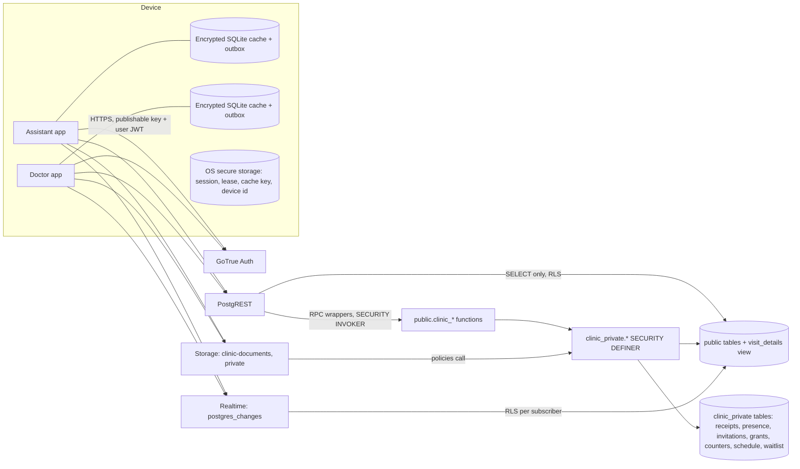

# Clinic Assistant / Clinic Doctor — security and reliability assessment

**Date:** 17 September 2026 · **Scope:** both Flutter apps, the shared `clinic_core` package, all eleven deployed migrations, the hosted `clinic-chatgpt-dev` project (`geikkygtnsgbtajyqdvc`), dependencies, and mobile configuration · **Method:** full source review, live read-only inspection of the hosted schema, roles, grants, policies, functions, triggers, publication and bucket, local PGlite reproduction, and Flutter unit tests.

**Rules observed:** no destructive action, no denial-of-service testing, no real data. Hosted probes were read-only catalog and aggregate queries. Reproductions run against fictional fixtures in PGlite.

**Result:** 0 Critical · 1 High · 5 Medium · 7 Low · 6 Informational, plus 7 functional bugs. No exploitable cross-tenant, privilege-escalation, RLS-bypass or injection path was found. The High finding is a reliability defect that halts a device's clinic operations; it is fixed in this branch. The Medium security findings are input-bound, integrity, and configuration issues; one is fixed by a migration deployed on 17 September 2026, the rest are specified with code.

---

## 1. Executive security overview

### Architecture in one paragraph

Two Flutter apps (Assistant, Doctor) share one package. Every network call goes through the official Supabase SDK to one project: GoTrue for email/password auth (PKCE), PostgREST for reads of `public` tables and RPC calls, Storage for a single private bucket, and Realtime for change signals. There are **no Edge Functions** and no custom server code. All business logic and authorization live in PostgreSQL: `public` holds RLS-protected tables that clients may only `SELECT`; every write goes through `SECURITY DEFINER` functions in the unexposed `clinic_private` schema, reached via thin `SECURITY INVOKER` wrappers in `public`. Each device keeps an encrypted SQLite cache (sqlite3mc, key in OS secure storage) with a transactional outbox.

### Trust boundaries

| Boundary | Enforcement | Verified |
|---|---|---|
| Client → PostgREST reads | RLS `SELECT` policies on 11 tables, keyed on `clinic_private.allowed(clinic_id, capability)` | live catalog |
| Client → writes | No `INSERT/UPDATE/DELETE` grants; RPC wrappers only | live grants |
| `public` wrapper → `clinic_private` implementation | `SECURITY DEFINER`, `search_path=''`, owner `postgres`, every function re-checks `auth.uid()` and membership | live `pg_proc` |
| Client → Storage bytes | Private bucket; `INSERT` only to an exact pending path owned by the caller; `SELECT` only with an unexpired 90-second lease row; no `UPDATE`/`DELETE` policy | live `pg_policies` |
| Client → Realtime | `postgres_changes` on three tables, RLS applied per subscriber | design + publication list |
| Doctor ↔ Assistant | Role column on membership; `clinical_read` flag; `is_admin` limited to doctors by CHECK | live constraints |
| Device at rest | Encrypted cache, secure-storage session and lease, `allowBackup=false`, `FLAG_SECURE` | manifests, code |

### Highest-risk architectural weaknesses

1. **Availability is a single shared queue.** One refused request on a device blocked every later request and every critical action on that device (BUG-001). Fixed here.
2. **Server input bounds were incomplete.** Amendments were capped; ordinary visit, patient and appointment saves were not (SEC-001). Fixed here; migration deployed to clinic-chatgpt-dev on 17 September 2026.
3. **Document content is verified only by the client.** The server records a client-asserted digest and enforces MIME by header only (SEC-002). Remediation specified.
4. **No second factor and no local lock on a device that can hold eight hours of patient data offline** (SEC-003, SEC-005). Configuration and product decisions.

### Findings by severity

| Severity | Security | Bugs |
|---|---|---|
| Critical | 0 | 0 |
| High | 0 | 1 |
| Medium | 5 | 2 |
| Low | 7 | 3 |
| Informational | 6 | 1 |

---

## 2. Architecture and attack surface



### Authentication model

Email + password through the Supabase SDK. Sign-up requires a 12–72 character password (client) and email confirmation is required server-side for clinic creation and invitation redemption (`email_confirmed_at is not null`). Sessions persist in `flutter_secure_storage` (`SecureSessionStorage`). Password recovery uses PKCE with app-specific custom-scheme callbacks; after reset the app performs a global sign-out. The client never decodes or trusts JWT claims; all authorization derives from `clinic_memberships` rows read inside definer functions.

### Authorization model

| Role | Read demographics/appointments | Read clinical | Write demographics/appointments | Write clinical | Staff admin | Audit read |
|---|---|---|---|---|---|---|
| anon | no | no | no | no | no | no |
| Assistant | own clinic | only with `clinical_read` | own clinic (not `alerts`) | no | no | no |
| Assistant + clinical_read | own clinic | own clinic | own clinic | no | no | no |
| Doctor | own clinic | own clinic | own clinic | own visits only | if `is_admin` | if `is_admin` |

Capability function (`clinic_private.allowed`): `read` = active member of unarchived clinic; `clinical_read` = doctor or flag; `clinical_write` = doctor; `admin` = `is_admin`.

### Entry-point inventory

| Entry point | Auth | Role | Input validation | RLS / definer | Notes |
|---|---|---|---|---|---|
| `GET /rest/v1/{clinics,clinic_memberships,patients,appointments,visits,visit_revisions,diagnoses,prescriptions,prescription_items,attachments,audit_events,visit_details}` | JWT | member (+capability) | PostgREST filters | RLS SELECT policies; view is `security_invoker` | no write grants |
| `rpc/clinic_search_patients` | JWT | member | bounded limit 1–100, `position()` matching (no LIKE) | `SECURITY INVOKER`, RLS applies | parameterized SQL |
| `rpc/clinic_apply_command` | JWT | member; visit needs doctor | see SEC-001 | wrapper → `apply_command` / `apply_visit_amendment` definer | receipts, advisory locks, `_expires_at` freshness |
| `rpc/clinic_create` | JWT, confirmed email | any | name 2–160 | definer | unbounded per user (SEC-006) |
| `rpc/clinic_invite_assistant`, `clinic_join`, `clinic_staff`, `clinic_set_staff_access` | JWT | admin / verified invitee | email regex, 64-char code, 20/h cap | definer | code hashed, 24 h, single use, revocation cutoff |
| `rpc/clinic_begin_attachment`, `finalize`, `fail`, `authorize_access`, `set_archived` | JWT | member (+clinical for clinical docs) | MIME allowlist, name regex, 1–20 MiB, sha256 hex | definer | see SEC-002 |
| `rpc/clinic_doctor_heartbeat`, `clinic_doctor_delivery_state`, `clinic_acknowledge_appointment` | JWT | doctor / member | UUIDs, version ≥ 1 | definer | presence 60 s, receipts immutable |
| `rpc/clinic_schedule` | JWT | member; settings need admin | period schema, ≤28, overlap check | definer | |
| Storage `POST clinic-documents/{clinic}/{patient}/{attachment}` | JWT | uploader | bucket MIME header + 20 MiB | policy → `attachment_object_allowed(name,true)` | `upsert:false`; no UPDATE policy |
| Storage `GET` same path | JWT | lease holder | — | policy → grant row unexpired | 90 s |
| Realtime `clinic:{clinicId}` postgres_changes on `patients`, `appointments`, `visits` | JWT | member | filter `clinic_id=eq.` | RLS per subscriber | full-row payloads (SEC-012) |
| Deep link `dev.homeversion.clinic.{assistant,doctor}://auth-callback/` | — | — | scheme/host/path match + auth params | SDK PKCE | SEC-004 |
| Local: `clinic_apply` via outbox, encrypted cache, share sheet, print dialog | device | — | client validation | — | SEC-005, SEC-007 |

Not present: GraphQL (pg_graphql not installed), Edge Functions, webhooks, `postMessage`, WebViews, HTML rendering.

---

## 3. Vulnerability inventory

| ID | Severity | Vulnerability | Component | Exploitability | Confidence | Status |
|---|---|---|---|---|---|---|
| SEC-001 | Medium | Unbounded text and list sizes on visit/patient/appointment/document writes | PostgreSQL `apply_command`, `begin_attachment` | authenticated member | Confirmed | Fixed (migration deployed 17 Sep 2026) |
| SEC-002 | Medium | Document integrity digest and MIME are client-asserted; server checks size only | `finalize_attachment`, Storage policy | authenticated uploader | Confirmed | Specified |
| SEC-003 | Medium | Leaked-password protection disabled; no MFA | Supabase Auth config | remote, credential stuffing | Confirmed (advisor) | Config action |
| SEC-005 | Medium | No local authentication gate on an 8-hour offline lease; no iOS screenshot protection | Apps | physical access | Confirmed | Recommendation |
| SEC-010 | Medium | Audit rows duplicate full clinical payloads readable by admin via REST | `audit_events` | admin only | Confirmed | Recommendation |
| SEC-004 | Low | Custom-scheme recovery callbacks are claimable by other apps; redirect allowlist unconfigured | Android/iOS, Auth | local app + phishing | Confirmed | Recommendation |
| SEC-006 | Low | Unbounded clinic creation per user; unbounded presence device rows per doctor | `create_clinic`, `clinic_doctor_heartbeat` | authenticated | Confirmed | Specified |
| SEC-007 | Low | Decrypted share copy can persist in temp dir after process death | Documents share | physical access | Confirmed | Fixed |
| SEC-011 | Low | `authenticated` holds USAGE on `clinic_private` and EXECUTE on definer implementations | PostgreSQL grants | only if schema exposed | Confirmed | Hardening |
| SEC-013 | Low | Member-uploaded PDFs rendered by pdfium (pdfrx 2.5.0, 2.6.1 available); 7 direct deps behind | Client deps | malicious member | Confirmed | Recommendation |
| SEC-014 | Low | No certificate pinning, no root/jailbreak signal | Apps | network MITM with device trust store | Confirmed | Long term |
| SEC-015 | Low | `visit_details` VERSION_CONFLICT detail echoes the full server row | `apply_command` | same-clinic member | Confirmed | Accept |
| SEC-008 | Info | Every member can see the doctor's membership row | RLS `membership_read` | — | Confirmed | By design |
| SEC-009 | Info | Distinct error codes reveal whether a UUID exists in another clinic | `apply_command` | needs a foreign UUIDv4 | Confirmed | Accept |
| SEC-012 | Info | Realtime delivers full patient rows (PII) to every clinic member | Realtime | — | Confirmed | Accept |
| SEC-016 | Info | Assistant may `share` documents to external apps | product | — | Confirmed | Product |
| SEC-017 | Info | Publishable key committed only in ignored `config/development.json`; no privileged secret in repo | Repo | — | Confirmed | None |
| SEC-018 | Info | Storage objects can never be deleted by clients (retention by design); failed uploads accumulate | Storage | — | Confirmed | Ops |

### SEC-001 — Unbounded text and list sizes on ordinary writes

- **Severity:** Medium · **CVSS 3.1:** AV:N/AC:L/PR:L/UI:N/S:U/C:N/I:L/A:H — 6.5 · **Confidence:** Confirmed
- **Location:** live `clinic_private.apply_command` (deployed from `20260828185721_clinic_foundation.sql:326-447`, patched by `20260912110955` and `20260916215601`); `clinic_private.begin_attachment` (`20260829014008_clinic_documents.sql:59-137`); table definitions `clinic_foundation.sql:40-188`.
- **Component:** Supabase PostgreSQL.
- **Preconditions:** any active member (patient/appointment/attachment) or doctor (visit).
- **Vulnerable behaviour:** `apply_visit_amendment` caps the payload at 1 MiB, notes at 20 000, follow-up at 5 000, 50 diagnoses of ≤1 000 chars, 100 medications with per-field caps. The `visit/save` path applies none of these: `coalesce(p_payload->>'notes','')` is inserted unchecked and the diagnosis/medication loops are unbounded. `patients.notes/alerts/address/secondary_mobile`, `appointments.notes/appointment_type` and `attachments.notes` have no length constraints. Every save also copies the full `visit_details` JSON into `audit_events.previous_value` and `new_value`, tripling the stored size, and the row is then broadcast by Realtime and cached on every member's device.
- **Impact:** storage and egress exhaustion for the clinic and its devices; slow queries on `visit_details`; oversized encrypted caches on phones; the immutable audit table cannot be trimmed.
- **Evidence:** live definition contains no `length(` check on the save path; hosted `patients.notes` maximum today is 66 characters (no abuse observed).
- **Safe reproduction (PGlite):** `backend-tests/bounds.test.mjs` — before the migration, `visit/save` with 51 diagnoses or 20 001-character notes is accepted.
- **Root cause:** validation was added to the newer amendment function but not retrofitted to the original command; no table-level bounds.
- **Remediation (implemented):** `supabase/migrations/20260917114822_clinic_input_bounds.sql` adds CHECK constraints on every free-text column, bounds diagnosis and item counts through `position < 50` / `position < 100`, adds a 1 MiB payload guard and appointment time bounds (not null, not more than one year past, not more than two years ahead) to `apply_command` using the project's guarded string-patch pattern. Client validation mirrors the limits (`Patient.validate`, `Appointment.validate`, `ClinicDocument.validate`) and `SupabaseClinicGateway.apply` maps SQLSTATE `23514` to a clear message.
- **Verification:** `npm test` → `bounds.test.mjs` 5/5. After deployment: `select conname from pg_constraint where conname like '%_bound'` returns 16 rows; `pg_get_functiondef('clinic_private.apply_command(...)')` contains `pg_column_size(p_payload)`.
- **Adversarial review of the fix:** constraints are on the tables, so a future RPC cannot bypass them; the amendment path keeps its stricter checks; `23514` cannot be turned into a retry storm because the client marks it `failed`, not `pending`. Residual: PostgREST body size before the 1 MiB check is bounded only by platform limits.

### SEC-002 — Document digest and MIME are client-asserted

- **Severity:** Medium · **CVSS 3.1:** AV:N/AC:L/PR:L/UI:R/S:U/C:N/I:L/A:L — 4.6 · **Confidence:** Confirmed
- **Location:** `clinic_documents.sql:139-176` (`finalize_attachment` compares only `o.metadata->>'size'`); Storage bucket `allowed_mime_types` acts on the declared `Content-Type`; magic-byte detection only in `ClinicDocument.detectContentType` (client).
- **Preconditions:** authenticated member with upload permission.
- **Vulnerable behaviour:** the SHA-256 recorded at `begin_attachment` is never compared with the stored object. A client can upload bytes whose hash differs from the recorded digest, or upload a non-PDF labelled `application/pdf`. Downloading clients verify the hash and refuse mismatches, so the realistic effects are: (a) a document nobody else can open while metadata and audit claim it is ready; (b) arbitrary bytes reaching other members' PDF/image decoders when uploader controls both bytes and digest.
- **Evidence:** the hosted object's `metadata->>'eTag'` is a quoted 32-hex MD5-shaped value (`etag_is_md5_shaped = true`), so the server does have a content checksum it could compare.
- **Remediation (specified, not deployed):** add `md5 bytea` to `attachments`, accept `p_md5_hex` in `begin_attachment` (client computes with `package:crypto`), and in `finalize_attachment`:
  ```sql
  v_etag = regexp_replace(o.metadata->>'eTag', '"', '', 'g');
  if v_etag ~ '^[0-9a-f]{32}$' and decode(v_etag,'hex') <> v_attachment.md5 then
    raise exception 'ATTACHMENT_DIGEST_MISMATCH';
  end if;
  ```
  **Validate first**: upload one fictional file through the app, then `select metadata->>'eTag' from storage.objects where name='<path>'` and compare with `md5sum` of the file. If they match for JPEG/PNG/PDF at 1 KB and 15 MB, deploy; if the bucket uses SSE-KMS the eTag is not an MD5 and this check must stay disabled. Keep the client-side hash check as the second layer.
- **Regression test:** extend `clinic.test.mjs` document lifecycle with a mismatched eTag fixture expecting `ATTACHMENT_DIGEST_MISMATCH`.

### SEC-003 — Leaked-password protection disabled; no MFA

- **Severity:** Medium · **CVSS 3.1:** AV:N/AC:L/PR:N/UI:N/S:U/C:H/I:H/A:N — 8.1 for a successful takeover; likelihood reduced by the 12-character minimum · **Confidence:** Confirmed (Supabase security advisor WARN `auth_leaked_password_protection`).
- **Impact:** a doctor account taken over through credential stuffing has full clinical read/write and staff administration for its clinic.
- **Remediation:** Dashboard → Authentication → Password security: enable "Prevent use of leaked passwords". Enable TOTP MFA for doctors (SDK: `auth.mfa.enroll(factorType: FactorType.totp)`) and require `aal2` for the Doctor app; add `auth.jwt()->>'aal' = 'aal2'` to the doctor branch of `clinic_private.allowed` once enrolled.
- **Verification:** advisor WARN disappears; `select count(*) from auth.mfa_factors where status='verified'` ≥ number of doctors.

### SEC-005 — No local authentication gate on offline data

- **Severity:** Medium · **Confidence:** Confirmed (`access_lease.dart:7`, 8-hour lease; `MainActivity.kt` sets `FLAG_SECURE` on Android only).
- **Vulnerable behaviour:** an unlocked phone opens the app straight into cached patient records, and the Assistant may share document bytes to any external app. iOS has no screenshot suppression.
- **Remediation:** require `local_auth` (biometric/PIN) on cold start and after 5 minutes in background; shorten the offline lease to a product-agreed value; restrict `share` purpose to doctors or make it a clinic setting; on iOS, blank the window in `sceneWillResignActive`.

### SEC-010 — Audit rows duplicate full clinical payloads

- **Severity:** Medium (privacy/retention) · **Confidence:** Confirmed (`apply_command` lines 455-467; `audit_events` RLS `admin`).
- **Behaviour:** every save stores the complete before/after `visit_details` JSON. The client selects a safe column list, but an admin JWT can `GET /rest/v1/audit_events?select=new_value` via PostgREST. Retention of clinical text in an immutable table with no purge is a data-protection concern.
- **Remediation:** store a diff or field list instead of full documents; or move payload columns to a `clinic_private.audit_payloads` table with no client grant; define retention.

### SEC-004 — Recovery deep links on custom schemes

- **Severity:** Low · **Confidence:** Confirmed (manifests; `auth_screen.dart:18-41`; README states the redirect allowlist is not yet configured).
- **Behaviour:** any Android app can register `dev.homeversion.clinic.assistant://`; a malicious app could receive the recovery callback. PKCE binds the `code` to the verifier stored in the legitimate app, so the intercepted code is unusable; impact is limited to a denial of the reset. Today the allowlist is unconfigured, so recovery does not work at all.
- **Remediation:** configure the two redirect URLs; for production move to verified App Links / Universal Links on an HTTPS domain; keep `detectSessionInUriPredicate` restricted to recovery.

### SEC-006 — Unbounded creation of clinics and presence rows

- **Severity:** Low · **Confidence:** Confirmed (`create_clinic` has no cap; `clinic_doctor_heartbeat` upserts any `p_device_id`).
- **Remediation:** `if (select count(*) from public.clinic_memberships where user_id=auth.uid() and role='doctor') >= 20 then raise exception 'CLINIC_LIMIT'; end if;` and cap presence rows per doctor at e.g. 10 by deleting the oldest expired rows on insert. Add to a future migration.

### SEC-007 — Decrypted share copy may persist

- **Severity:** Low · **Confidence:** Confirmed (`document_screen.dart` `share()` writes to `getTemporaryDirectory()` and deletes in `finally`).
- **Remediation (implemented):** `_sweepSharedCopies()` deletes `clinic_*` files older than 10 minutes from the temp directory whenever the documents panel opens.

### SEC-011 — Private schema reachable by `authenticated` if ever exposed

- **Severity:** Low · **Confidence:** Confirmed (`has_schema_privilege('authenticated','clinic_private','USAGE') = true`; EXECUTE granted on 22 private functions).
- **Behaviour:** the `SECURITY INVOKER` wrappers require these grants. The implementations enforce their own authorization, so exposure would not bypass checks, but it widens the surface if `clinic_private` is ever added to PostgREST's exposed schemas.
- **Remediation:** make wrappers `SECURITY DEFINER` with `search_path=''` and revoke EXECUTE on the implementations from `authenticated`; add a CI check that PostgREST `db_schemas` stays `public`.

### SEC-013 — PDF rendering surface and dependency drift

- **Severity:** Low · **Confidence:** Confirmed (`pdfrx 2.5.0` current, 2.6.1 available; `npm audit` 0 vulnerabilities; `flutter pub get` reports no advisories).
- **Remediation:** upgrade `pdfrx`, `drift`, `sqlite3`, `flutter_secure_storage`, `file_picker`, `go_router`, `flutter_riverpod`; add `dart pub outdated` and `npm audit` to CI; pair with SEC-002 so the server rejects mislabelled bytes.

### SEC-014, SEC-015, SEC-008, SEC-009, SEC-012, SEC-016 to SEC-018

Covered in the table; none requires code change now. SEC-015: the `VERSION_CONFLICT` detail returns rows the caller can already read under RLS (patients/appointments to members, visits to doctors only), so it is not a disclosure.

---

## 4. Supabase security review

**Authentication.** PKCE flow (SDK default), secure session storage, 12–72 password rule, email confirmation enforced in SQL for clinic creation/join, global sign-out after password reset, membership re-verification before every sync and critical action with automatic logout on `access_changed`. Gaps: SEC-003, SEC-004; JWT lifetime, refresh-token reuse interval, rate limits, captcha and SMTP are dashboard settings I could not read (section 10).

**RLS matrix (live).**

| Table | RLS | SELECT | INSERT | UPDATE | DELETE | Risk |
|---|---|---|---|---|---|---|
| clinics | on | `allowed(id)` | — | — | — | none |
| clinic_memberships | on | `allowed(clinic_id) and (own or admin or role='doctor')` | — | — | — | SEC-008 (design) |
| patients, appointments | on | `allowed(clinic_id)` | — | — | — | none |
| visits, visit_revisions, diagnoses, prescriptions, prescription_items | on | `allowed(clinic_id,'clinical_read')` | — | — | — | none |
| attachments | on | `allowed` and (`not clinical` or `clinical_read`) | — | — | — | none |
| audit_events | on | `allowed(clinic_id,'admin')` | — | — | — | SEC-010 |
| visit_details (view) | n/a | `security_invoker=true` → base RLS | — | — | — | none |
| clinic_private.* (8 tables) | on | no policy, no grant | — | — | — | default deny (advisor INFO, intentional) |
| storage.objects | on | lease-gated | exact pending path | none | none (also `protect_objects_delete`) | SEC-002 |

No `USING (true)`, no client-controlled tenant column, no UPDATE policy without WITH CHECK (there are no UPDATE policies), no ownership-change path: all writes are inside definer functions that take `clinic_id` and re-derive identity from `auth.uid()`.

**PostgreSQL privileges.** `anon` has no table, sequence or function privilege in `public`/`clinic_private`; `authenticated` has `SELECT` on 12 relations and `EXECUTE` on the wrappers (and the implementations, SEC-011); `audit_events_id_seq` revoked; default ACLs leave new objects to `postgres`/`supabase_admin` only. `service_role` and `postgres` bypass RLS as expected and never appear in client code.

**RPC and SECURITY DEFINER functions.** All 22 definer functions: owner `postgres`, `search_path=''`, fully-qualified references, `auth.uid()` null check first, membership check second, advisory locks for clinic-level serialization, exact-request receipt replay, `IMMUTABLE_HISTORY` triggers on revisions, diagnoses, prescriptions, items, audit and receipts. `clinic_search_patients` is `SECURITY INVOKER` and parameterized (`position()`, no `LIKE`, no dynamic SQL). No `EXECUTE format()` with user input anywhere. The string-patch migration pattern fails closed (`raise exception 'Unexpected ... definition'`).

**Storage.** One private bucket, 20 MiB, four MIME types; insert bound to an existing pending `attachments` row with `uploaded_by = auth.uid()` and the exact `clinic/patient/attachment` path (no user-controlled path segments); read bound to a 90-second grant that is deleted by trigger when the attachment leaves `ready`; no UPDATE policy (`upsert:false`), no DELETE. Gap: SEC-002.

**Realtime.** Publication contains exactly `patients`, `appointments`, `visits`; channel is `clinic:{id}` with `clinic_id` filter; RLS is evaluated per subscriber so an assistant without `clinical_read` receives no `visits` events. Broadcast/presence features unused. Subscription errors are swallowed; a 30-second poll is the fallback (BUG-005).

**Edge Functions.** None deployed, none in repo (verified: no `supabase/functions`).

**Secrets.** No `service_role`, JWT secret, database URL or private key anywhere in the tree (regex sweep of all text files). `config/development.json` (git-ignored) holds only the project URL and `sb_publishable_` key, which are public by design. `.env*`, `local.properties`, keystores, `.idea` are ignored and not tracked.

**Database roles.** `authenticator`, `anon`, `authenticated`: no bypassrls, no superuser. `postgres` owns everything with `bypassrls` — standard for Supabase; migrations run as it.

---

## 5. Exploitation chains

**Chain A — insider storage exhaustion (broken by this branch).** Assistant or doctor account → SEC-001 → 200 MB `visit/save` payloads → each write ×3 via audit → Realtime pushes the row to every device → caches grow, queries slow, project quota exhausted. Failed controls: none existed on the save path. Breakpoint: table CHECKs + 1 MiB guard (migration 20260917114822).

**Chain B — malicious document to code execution in a colleague's app.** Compromised member → uploads crafted bytes labelled `application/pdf` with matching self-computed SHA-256 (SEC-002) → colleague previews → pdfium parser flaw (SEC-013) → code runs inside the victim app with access to the decrypted cache and session. Preconditions: an unpatched pdfium bug. Breakpoints: server-side eTag/MD5 check and content sniffing (SEC-002 remediation), dependency currency, opening PDFs in the OS viewer instead of in-process.

**Chain C — lost unlocked phone.** Physical access → app opens without local auth (SEC-005) → 8-hour lease exposes cached records → `share` to external app exfiltrates document bytes (SEC-016). Breakpoints: biometric gate, shorter lease, doctor-only share.

**Chain D — credential stuffing to clinic takeover.** Reused password + SEC-003 (no leaked-password check, no MFA) → doctor account → invitation issuance, staff control, all clinical data. Breakpoints: HIBP check, TOTP MFA, aal2 requirement for doctors.

**Chain E — queue stall (broken by this branch).** Two devices reschedule the same appointment → second gets `VERSION_CONFLICT` → BUG-001 → outbox blocked → no handoff, completion or upload possible on that device until data is wiped. Breakpoint: conflict discard with evidence retention.

---

## 6. Functional bug inventory

| ID | Severity | Location | Trigger | Impact | Status |
|---|---|---|---|---|---|
| BUG-001 | High | `repository.dart` `_flush`/`discardRejectedOperation`; `workspace_screen.dart` | any `VERSION_CONFLICT` on an appointment or visit save | outbox permanently blocked; `_onlineCommand` refuses all critical actions while the queue is unclean → device cannot send, complete or upload | Fixed: `isDiscardable`, conflict discard with `sync_resolutions` evidence, UI button; test `security_regressions_test.dart` |
| BUG-002 | Medium | `supabase_gateway.dart` `apply()` | serialization failure / deadlock / statement timeout / pool exhaustion under the clinic-wide advisory lock | request marked `failed` (permanent) instead of retried | Fixed: `isTransientPostgrestCode`; test added |
| BUG-003 | Low | `apply_command` appointment save | `starts_at` null, more than a year in the past, or more than two years ahead | corrupt schedule rows; client-side `PAST_APPOINTMENT` never produced by server | Fixed in migration; test `bounds.test.mjs` |
| BUG-004 | Low | `repository.dart:1690` | clinic with > 2 000 active patients | records beyond page 40 never cached; server search still works | Documented; raise cap or add delta sync |
| BUG-005 | Low | `supabase_gateway.dart` `changes()` | `CHANNEL_ERROR`/`TIMED_OUT` | silent fallback to 30 s polling; no user signal | Surface status to `connectionWarning` |
| BUG-006 | Low | `apply_command` appointment save | `id` that exists in another clinic | misleading `APPOINTMENT_IDENTITY_CHANGED` instead of `CROSS_CLINIC_ID` | Cosmetic; UUIDv4 makes it unreachable in practice |
| BUG-007 | Info | `join_clinic` | code with surrounding whitespace | rejected before `btrim` | Client trims; harmless |

**BUG-001 detail.** Reproduction (Dart test): save an appointment, make the gateway answer `SyncConflict`, queue a second request; `syncSummary().pending` stays 1 and `discardRejectedOperation` threw `review_changed` because only `failed` was accepted. Root cause: the conflict resolution UI was built for patients only, and the discard path was later added for `failed` only, while the queue treats `conflict` and `failed` identically as blockers. Fix keeps the patient merge flow, allows discarding appointment/visit conflicts (the server never applied them), records the local content under `choice='discard:<type>'` in `sync_resolutions`, and restores the server row.

**BUG-002 detail.** `apply()` mapped every unknown `PostgrestException` to `rejected`. Because `apply_command` serializes each clinic with `pg_advisory_xact_lock`, `40001`/`40P01`/`57014` are realistic under load. Fix: SQLSTATE classes 08, 40, 53, `55P03`, `57014`, `57P0x` and `PGRST000-003` map to `unavailable` (retry with backoff).

---

## 7. Remediation plan

**Immediate (this branch, before next build)**
1. ~~Review and deploy `20260917114822_clinic_input_bounds.sql`~~ Deployed 17 September 2026 after approval; verified 16 constraints, payload guard and time bound live (SEC-001, BUG-003).
2. Ship the client fixes in this branch (BUG-001, BUG-002, SEC-007, client bounds).
3. Dashboard: enable leaked-password protection (SEC-003); add the two recovery redirect URLs (SEC-004).

**Short term (next sprint)**
4. SEC-002: validate eTag = MD5 on the dev project, then add `md5` verification to `finalize_attachment`.
5. SEC-005: biometric/PIN gate on launch and resume; iOS window blanking; decide on share policy.
6. SEC-003: TOTP MFA for doctors; require `aal2` in `allowed()` for doctor capabilities.
7. SEC-006: caps on clinics per user and presence rows per doctor.
8. SEC-013: dependency upgrades; CI job for `npm audit` and `dart pub outdated --show-all`.
9. BUG-005: surface Realtime channel status.

**Long term**
10. SEC-010: replace full-payload audit with field diffs; retention policy; move payload columns to a private table.
11. SEC-011: definer wrappers, revoke implementation EXECUTE from `authenticated`; CI assertion on exposed schemas.
12. SEC-014: certificate pinning for `*.supabase.co`, root/jailbreak signalling, Play Integrity / App Attest.
13. Delta/tombstone sync to remove the 2 000-patient reconcile cap (BUG-004) and shorten the offline lease.
14. Operational: alerting on advisor changes, failed-login rates, oversized rows; backup/restore drills.

---

## 8. Secure architecture recommendations

- **Keep authorization in the database.** The current pattern (SELECT-only RLS, definer implementations, invoker wrappers, receipts) is sound. Extend it with the wrapper hardening in SEC-011 and keep `clinic_private` out of the exposed schemas.
- **Bounds at the table, not only in functions.** Done for text and counts; apply the same to any future column.
- **Immutable ownership.** Already true: `clinic_id`, `doctor_id`, `patient_id` never change through any RPC; keep the `on conflict ... where` identity guards.
- **Second factor and device binding for clinicians.** MFA + `aal2`, and reuse the existing protected device UUID for a per-device allowlist per doctor.
- **Server-side content validation for documents.** eTag/MD5 now; consider a Storage webhook or scheduled function that sniffs magic bytes and quarantines mismatches later.
- **Least privilege on the client.** Restrict `share` to doctors, gate the app locally, blank on background, shorten the lease.
- **Observability.** Log auth events and RPC rejections to a private table with retention; alert on `23514`, `42501` spikes and on advisor regressions.
- **CI.** Run `npm test`, `flutter analyze`, `flutter test`, `npm audit`, `dart pub outdated` on every PR; fail on any new `USING (true)` policy or on `security_invoker=false` views (a one-line SQL assertion in the PGlite suite).

---

## 9. Security regression tests

Existing (34 PGlite + 57 Flutter) already assert: anon denied everywhere; direct writes denied; cross-clinic reads and writes denied; membership visibility scoping; replay idempotence and payload reuse rejection; assistant cannot set alerts; queue slot uniqueness; revoked membership cannot replay; immutable history even as `postgres`; invitation binding/expiry/revocation cutoff; document path/lease/archive; presence and receipt rules; scheduling rules.

Added in this branch:

| Property | Test |
|---|---|
| Oversized patient/appointment/visit/document text rejected atomically; count caps; payload > 1 MiB; appointment time bounds | `backend-tests/bounds.test.mjs` (5 tests) |
| Appointment/visit conflicts are discardable, unblock the queue, restore the server row, retain evidence; patient conflicts are not | `test/security_regressions_test.dart` |
| Transient SQLSTATE/PostgREST codes retry; verdict codes do not | same |
| Client caps mirror server caps | same |

Recommended next: eTag/MD5 mismatch test (SEC-002); `aal2` requirement test once MFA lands; CI assertion `select count(*) from pg_policies where qual='true'` = 0.

---

## 10. Unverified areas

| Missing | Why it matters | Inspect | Method |
|---|---|---|---|
| Auth settings: JWT expiry, refresh-token reuse interval, rate limits, captcha, email-confirmation toggle, SMTP | session lifetime, brute-force resistance, enumeration | Dashboard → Authentication → Settings / Rate limits | compare with Supabase hardening guide; test 20 failed logins → 429 |
| Redirect URL allowlist | recovery flow works and only to app schemes | Authentication → URL Configuration | request a reset with an owned fictional account on a device |
| Storage eTag = MD5 assumption | SEC-002 remediation correctness | `storage.objects.metadata` after a known upload | compare with `md5sum` |
| PostgREST exposed schemas | SEC-011 residual | Dashboard → API settings | must list `public` only (`graphql_public` acceptable, pg_graphql not installed) |
| Realtime RLS at runtime | assistant without `clinical_read` must not receive `visits` events | two-device test | subscribe as assistant, save a visit as doctor, expect no event |
| Network restrictions / SSL enforcement on the project | direct DB exposure | Dashboard → Database → Network | restrict to none/Supabase-only |
| iOS build, signing, ATS, background blanking | never built | macOS/Xcode | build, run, screenshot in app switcher |
| Android release signing and `debuggable` | release integrity | `build.gradle.kts` release block | configure `key.properties`, verify `aapt dump badging` |
| Hosted concurrency under the clinic advisory lock | BUG-002 frequency, latency | load test | 20 concurrent `apply_command` calls per clinic, observe `40001`/`57014` |

None of these was assumed secure; each is listed with the exact check to run.
